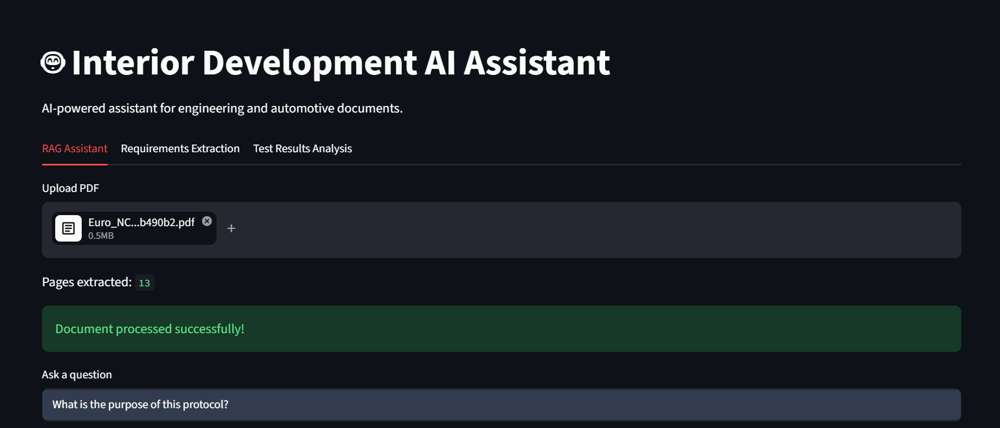
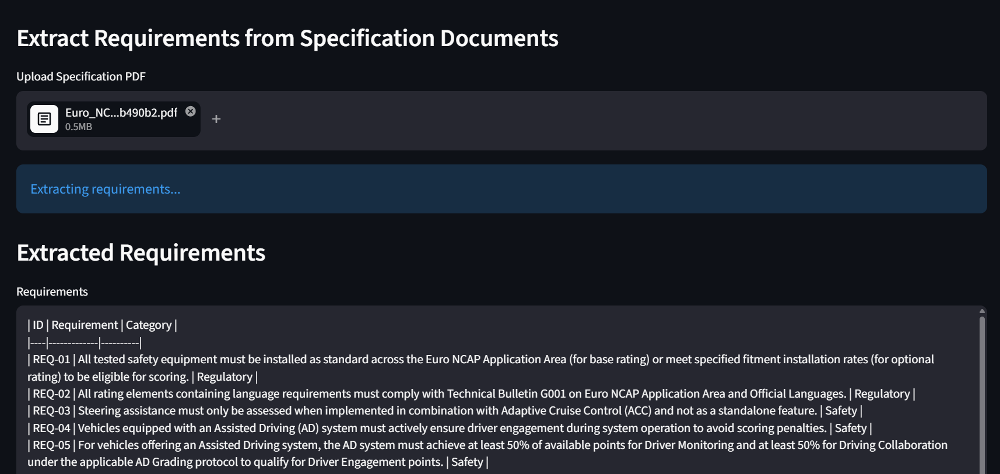
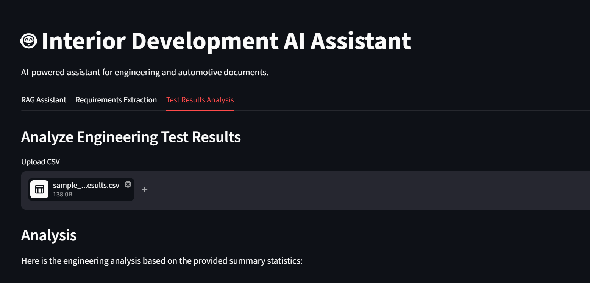

# Interior Development AI Assistant

## Overview

AI-powered assistant for engineering and automotive documents.

## Features

- RAG-based Question Answering
- Page-level Citations
- Requirements Extraction
- Excel Export
- Test Results Analysis
- Evaluation Framework

## Technologies

- Python
- Gemini
- LangChain
- FAISS
- Streamlit
- Pandas

## Screenshots

### RAG Assistant

### Requirements Extraction

### Test Results Analysis

